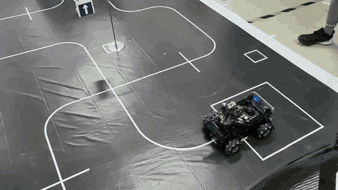
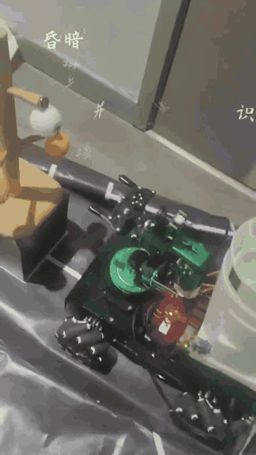
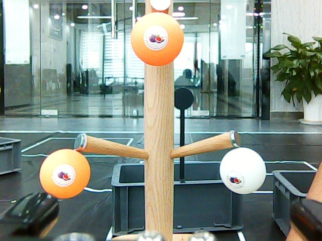
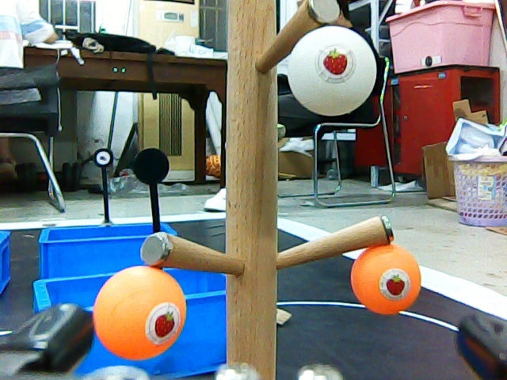

# RAICOM Robot Developer Competition

This Smart Orchard robot competed in the CAIR Engineering Competition track of the **2023 RAICOM Robot Developer Competition**. The team earned **Second Prize at the national finals**.

A Jetson Nano coordinates route selection, YOLOv5 object detection, a calibrated picking arm and compartment-based fruit storage. A separate chassis controller handles line following and receives route commands over serial. [RAICOM CAIR rules](https://raicom.com.cn/content.html?cid=715)

## Robot Demonstrations / 实机展示

### Line Following and Route Navigation

The robot leaves the start box and follows the marked course through curves and intersections toward the orchard stations.

<picture>
  <source type="image/webp" srcset="docs/media/line-following-animation.webp">
  
</picture>

### Fruit Picking and Transfer

A close-up shows the arm approaching the fruit props, closing the gripper, lifting the target and transferring it to the onboard storage area.

<picture>
  <source type="image/webp" srcset="docs/media/fruit-picking-animation.webp">
  
</picture>

## Reproduce on a Desktop

### Replay the grasp logic

Run these commands from the repository root with Python 3.11 or 3.12.

```bash
python main.py replay examples/orchard-stand.json
python main.py replay examples/strawberry-target.json
python -m unittest discover -s tests
```

The replay uses recorded annotations to exercise the controller's 128-byte detection format, fruit selection and camera-to-gripper geometry. Each example returns a detected fruit class and grasp targets in centimetres and degrees.

### Run YOLOv5 inference on the CPU

Use the competition's local `best.wts` file, the TensorRTx export of the trained weights. The exporter rebuilds its nine-class YOLOv5 graph in ONNX.

```bash
python -m pip install -r requirements.txt
python -m pip install onnx==1.19.1
python tools/export_wts.py /path/to/best.wts orchard.onnx
python main.py infer orchard.onnx examples/images/orchard-stand.jpg --overlay predicted.png
```

Verified on Windows with Python 3.12. The supplied WTS export selected fig and strawberry on the respective example images and produced grasp targets using the same frame decoder as the robot.

## Dataset / 数据集

The archived Smart Orchard capture set has **1,383 JPEG images** paired with YOLO bounding-box text files. The saved splits contain **969 training, 207 validation and 207 test images**. Its annotation class list is `ball`, `fig`, `blueberry`, `strawberry` and `red jujube`.

The competition weight export uses nine classes. It distinguishes the three direction signs, four fruit labels, and yellow and white balls. Recreating that detector from training data requires the corresponding nine-class annotations. The two examples below retain the archive's five-class annotations.

<p>
  
  
</p>

Audit the sample pairs or substitute your own local image and label directories.

```bash
python tools/audit_dataset.py examples/images examples/labels
```

The full archive has one `.txt` file containing class names where bounding boxes are expected. The audit reports its line numbers so it can be checked before training.

## Jetson Controller

The `robot` entry point uses the kit's arm SDK (`Arm_Lib`), USB camera, serial chassis controller, local inverse-kinematics service and a compatible TensorRT engine and plugin. Install the matching PyCUDA, TensorRT, OpenCV, NumPy and pySerial versions on the Jetson. The paths and serial device are supplied at launch.

```bash
python3 main.py robot --engine /path/to/best.engine --plugin /path/to/libmyplugins.so --serial-port /dev/ttyUSB0 --ik-socket /path/to/server.sock
```

Physical testing requires the original chassis firmware, the arm service and calibration for the equipment in `params.py`. The desktop verification covers replay, model export and CPU inference.

The TensorRT adapter is based on the [TensorRTx YOLOv5 implementation](https://github.com/wang-xinyu/tensorrtx/tree/master/yolov5).
